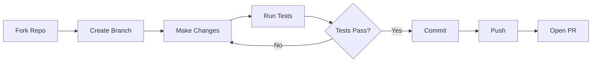
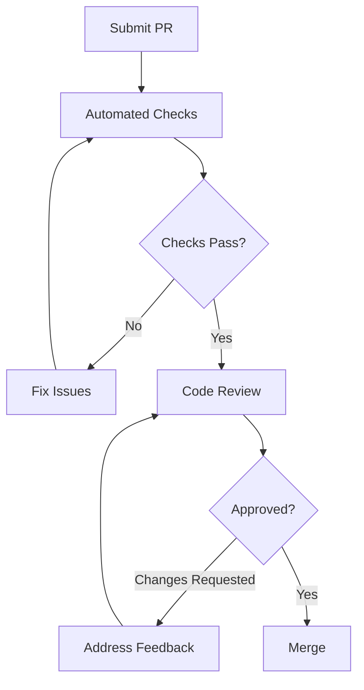

# Contributing

Thank you for your interest in contributing to nagents! This guide will help you get started.

## Getting Started

### Prerequisites

- Python 3.12–3.15
- [Poetry](https://python-poetry.org/) for the workflow below, or an existing virtual environment with pip
- Git for version control

These are the Python library/client prerequisites. Native harness development
also requires **Rust 1.93+, a C compiler** (bundled SQLite), and **Python 3.13**
for the installed-source launcher. The shared React frontend uses Node
**24.20.0** to match the distribution-build workflow. Run
`npm ci --prefix src/nagents/web-ui` before building the Rust binary or running
all pre-commit hooks. The Rust binary embeds the built assets and doesn't need
Node at runtime.

### Development Setup

=== "Quick Setup"

    ```bash
    # Clone the repository
    git clone https://github.com/abi-jey/nagents.git
    cd nagents

    # Install dependencies
    poetry install -E dev -E voice -E web

    # Install pre-commit hooks
    poetry run pre-commit install

    # Verify setup
    poetry run pytest
    ```

=== "Detailed Setup"

    ```bash
    # Clone the repository
    git clone https://github.com/abi-jey/nagents.git
    cd nagents

    # Create virtual environment and install all dependencies
    poetry install -E dev -E docs -E voice -E web  # (1)!

    # Install pre-commit hooks
    poetry run pre-commit install

    # Run the full test suite
    poetry run pytest -v

    # Run type checking
    poetry run mypy src/nagents

    # Build documentation and check warnings
    poetry run mkdocs build --strict
    ```

    1. These are package extras from `[project.optional-dependencies]`, not Poetry dependency groups. `dev`, `voice`, and `web` match the test installation in CI; `docs` adds MkDocs and mkdocstrings.

If you already use a local `.venv`, keep that environment rather than letting
multiple tools manage it. The equivalent editable install is
`.venv/bin/python -m pip install -e '.[dev,docs,voice,web]'`; use `.venv/bin/pytest`,
`.venv/bin/mypy`, and `.venv/bin/mkdocs` in place of `poetry run` below.
The build backend is Hatchling, regardless of the environment manager.

!!! important "Test the checkout, not a release snapshot"
    Published wheels include the terminal/headless CLI and built `ngn serve`
    frontend (v0.15.0 is historical packaging evidence, not a latest-version
    recommendation). Use an editable checkout for development; it
    can contain changes beyond an installed release, and matching version
    metadata alone does not prove matching code. See
    [release availability](../guide/ngn-installation.md#release-availability).

### Web Client Development

The React/TypeScript frontend lives in `src/nagents/web-ui/` and is used by both
the [Rust host](https://github.com/abi-jey/nagents/blob/main/ngn/README.md#build-and-inspect-from-source) and the Python
backend (`src/nagents/web/`). To develop against Python with the checkout installed
in `.venv`, run from the repository root:

```bash
.venv/bin/python -m pip install -e '.[web]'
npm --prefix src/nagents/web-ui ci
npm --prefix src/nagents/web-ui run typecheck
npm --prefix src/nagents/web-ui test
npm --prefix src/nagents/web-ui run build
.venv/bin/ngn serve --dev --demo
```

Use Node.js `24.20.0` to match the current CI build. Vite emits assets into
`src/nagents/web/static/`; build them before packaging or launching without `--dev`.
The wheel includes generated assets, while the source distribution also carries
the frontend source and lockfile. Installing `[web]` adds optional Python HTTP
dependencies, not a JavaScript build step. Plain `ngn serve` uses the verified
bundle without building or reloading, and is also the Docker default.
`ngn serve --dev` installs locked npm dependencies and builds when assets are
missing or stale, then watches Python and frontend source to restart the backend
and rebuild frontend changes. Refresh the browser after reload; active tasks are
cancelled by a restart. Use a separate virtualenv and editable installation in
each worktree. See the [web client guide](../guide/ngn-web.md) for operation.

## Development Workflow



### Creating a Branch

```bash
# Create a feature branch
git checkout -b feature/your-feature-name

# Or a bugfix branch
git checkout -b fix/issue-description
```

!!! tip "Branch Naming"
    Use descriptive branch names:

    - `feature/add-streaming-support`
    - `fix/session-manager-memory-leak`
    - `docs/update-quickstart`
    - `refactor/simplify-provider-interface`

## Code Standards

### Code Style

We use [Ruff](https://github.com/astral-sh/ruff) for linting and formatting:

```bash
# Format code
poetry run ruff format .

# Lint code
poetry run ruff check .

# Fix auto-fixable issues
poetry run ruff check --fix .
```

### Type Hints

All code must include type hints. We use [mypy](https://mypy-lang.org/) for type checking:

```bash
poetry run mypy src/nagents
```

??? example "Type Hint Examples"

    ```python
    from nagents import Message


    def user_message(content: str) -> Message:
        return Message(role="user", content=content)
    ```

### Docstrings

Use Google-style docstrings:

```python
def percentage(percent: float, amount: float) -> float:
    """Calculate a percentage of an amount.

    Args:
        percent: Percentage to calculate, such as 15.
        amount: Original amount.

    Returns:
        The calculated portion of the amount.

    Example:
        >>> percentage(15, 100)
        15.0
    """
    return percent * amount / 100
```

## Testing

### Running Tests

```bash
# Run all tests
poetry run pytest

# Run with coverage
poetry run pytest --cov=nagents --cov-report=html

# Run specific test file
poetry run pytest tests/agent/test_dynamic_tools.py

# Run tests matching a pattern
poetry run pytest -k "test_session"

# Run with verbose output
poetry run pytest -v
```

### Writing Tests

Tests use both synchronous pytest functions with `asyncio.run()` and async pytest
scenarios. **`pytest-asyncio>=1.0` is declared in the `dev` extra**, with the
default fixture loop scope configured in `pyproject.toml`. Follow the surrounding
test's style; there is no need to convert existing synchronous tests. Use `tmp_path` for
databases and synthetic credentials with mocked providers/HTTP, not real API
keys. `tests/conftest.py` isolates user configuration and data directories.

```python title="tests/test_session_example.py"
import asyncio
from pathlib import Path

from nagents import Message, SessionManager


def test_session_history(tmp_path: Path) -> None:
    async def scenario() -> None:
        manager = SessionManager(tmp_path / "test.db")
        session_id = await manager.get_or_create_session("conversation-1", "user-1")
        await manager.add_message(session_id, Message(role="user", content="Hello"))

        history = await manager.get_history(session_id)
        assert len(history) == 1
        assert history[0].content == "Hello"
        assert await manager.session_exists(session_id)

    asyncio.run(scenario())
```

For an agent test with a fake provider, see `tests/agent/test_dynamic_tools.py`. For
HTTP-contract fixtures, see `tests/providers/test_gateway_provider.py`. Keep live-service
experiments explicit and separate from the default test suite.

### Test Markers

The custom marker currently registered in `tests/conftest.py` is
`@pytest.mark.requires_posix`. Those tests are automatically skipped on
non-POSIX hosts. Select them with `poetry run pytest -m requires_posix` or
exclude them with `poetry run pytest -m "not requires_posix"`.

There are no registered `unit`, `integration`, or `slow` marker groups. Select
tests by file or `-k` expression instead of assuming those categories exist.

## Pre-commit Hooks

After `pre-commit install`, hooks run automatically on `git commit`. The checked-in
`.pre-commit-config.yaml` is authoritative for hook versions and arguments. It
includes whitespace, YAML, large-file and merge-conflict checks, Ruff linting
and formatting, mypy, and the native Rust/adapter/browser checks (17 hooks in
total). In particular, the YAML hook allows MkDocs' Python
tags; do not replace its configuration with a generic YAML example.

Run hooks manually:

```bash
# Run on all files
poetry run pre-commit run --all-files

# Run specific hook
poetry run pre-commit run ruff-check --all-files
```

## Dependency Vulnerability Scan

The CI workflow audits dependencies on pull requests to `main`, pushes to
`main`, release tags, and manual runs. OSV-Scanner checks Poetry, npm, Cargo,
Linux and macOS installer wheel locks, and the pinned benchmark and contract
tools. It also checks the Python dependencies resolved for CI and the Docker
build on Python 3.12, without installing them. `pip-audit` (PyPI advisory
service), `npm audit` (npm registry), and `cargo-audit` (RustSec) independently
check those same inputs for their respective ecosystems.

Vulnerability findings and scan errors, including empty reports and skipped
PyPI packages, fail the check. RustSec unsoundness warnings also fail it; its
other informational warnings are printed. PyPI and container publishing wait
for the audit, and the coordinated GitHub release waits for PyPI.

The job log and summary show each scanner's version and advisory source,
scanned package counts, exit codes, and findings. Download
`dependency-audit-reports-*` from the workflow run for the original scanner
JSON and logs, even when the audit fails. Use the IDs, affected versions, and
available fixes to update the flagged dependency. These checks do not scan
container base images, system packages, or the bundled Python interpreter.

## Documentation

### Building Docs

```bash
# Serve docs locally with hot reload
poetry run mkdocs serve

# Build static docs
poetry run mkdocs build --strict
```

The API reference is generated from this checkout's `src/nagents` using
mkdocstrings. Keep navigation targets and local links valid, and distinguish
research/proposals from implemented behavior. Do not infer feature availability
from a package version or an unverified upstream model name.

### Documentation Style

Use Material for MkDocs features:

=== "Admonitions"

    ```markdown
    !!! note "Title"
        Note content here.

    !!! warning
        Warning without custom title.

    ??? tip "Collapsible"
        Hidden by default.
    ```

=== "Code Blocks"

    ````markdown
    ```python title="example.py" linenums="1" hl_lines="2 3"
    def hello():
        message = "Hello"  # Highlighted
        print(message)     # Highlighted
    ```
    ````

=== "Tabs"

    ```markdown
    === "Python"
        ```python
        print("Hello")
        ```

    === "JavaScript"
        ```javascript
        console.log("Hello");
        ```
    ```

## Pull Request Process

### Before Submitting

- [ ] Code follows project style guidelines
- [ ] All tests pass locally
- [ ] Pre-commit hooks pass
- [ ] Documentation is updated (if applicable)
- [ ] Commit messages are clear and descriptive

### PR Template

```markdown
## Description
Brief description of changes.

## Type of Change
- [ ] Bug fix
- [ ] New feature
- [ ] Breaking change
- [ ] Documentation update

## Testing
Describe how to test the changes.

## Checklist
- [ ] Tests added/updated
- [ ] Documentation updated
- [ ] CHANGELOG updated (if applicable)
```

### Review Process



## Issue Guidelines

### Reporting Bugs

!!! bug "Bug Report Template"

    **Description**: Clear description of the bug

    **Steps to Reproduce**:
    1. Step one
    2. Step two
    3. ...

    **Expected Behavior**: What should happen

    **Actual Behavior**: What actually happens

    **Environment**:
    - OS: [e.g., Ubuntu 22.04]
    - Python: [e.g., 3.12.10]
    - nagents version: [e.g., 0.1.0]

### Feature Requests

!!! tip "Feature Request Template"

    **Problem**: What problem does this solve?

    **Proposed Solution**: How should it work?

    **Alternatives**: Other approaches considered

    **Additional Context**: Any other information

## Release Process

Follow [coordinated releases and candidate integrity](../guide/releases.md).
Starting with **0.100.2**, shared releases use one exact tested main commit,
one tag/GitHub release `v0.100.2`, and matching PyPI core/native/adapter versions.
Root CI publishes the verified core to PyPI before calling the reusable native
release workflow; the latter verifies exact published artifacts and official
bundle/browser acceptance before creating the single GitHub release.

Do not bump already-correct `0.100.2` metadata merely to trigger publication,
reuse/force a tag, overwrite artifacts, or infer release readiness from a local
source run. Alpha/dev are PyPI-only. A CI image push is not a production rollout.
Documentation deployment is a separate workflow. Release actions require explicit
maintainer authorization; this guide does not authorize tagging or deployment.

Version numbering follows [Semantic Versioning](https://semver.org/):

- **MAJOR**: Breaking changes
- **MINOR**: New features (backwards compatible)
- **PATCH**: Bug fixes (backwards compatible)

## Getting Help

- **GitHub Issues**: For bugs and feature requests
- **GitHub Discussions**: For questions and general discussion
- **Pull Requests**: For code contributions

!!! info "Code of Conduct"
    Please be respectful and constructive in all interactions. We're all here to build something great together.

## License

By contributing, you agree that your contributions will be licensed under the project's MIT License.
