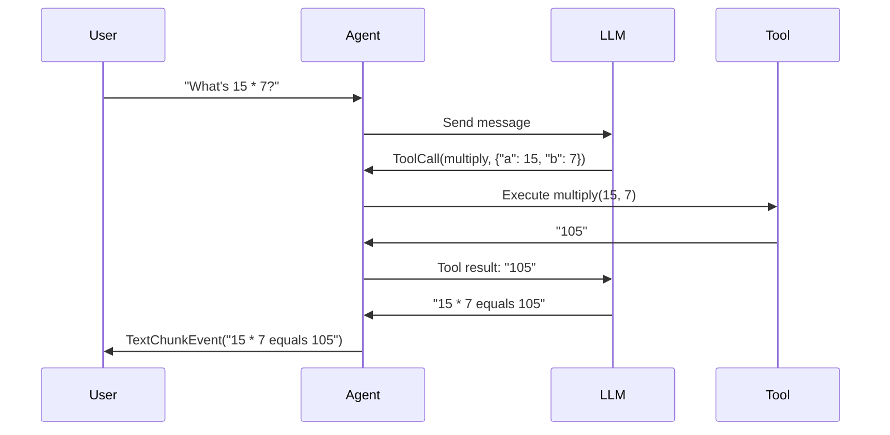

# Tools

Tools allow your agent to call Python functions during conversations, enabling it to perform actions, fetch data, and interact with external systems.

## Automatic tools in ngn

Put Python modules in `.agents/tools/` and mark exported functions with `@tool`:

```python title=".agents/tools/numbers.py"
from nagents import tool


def _check(value: int) -> int:
    return value


@tool
def multiply(a: int, b: int) -> int:
    """Multiply two integers."""
    return _check(a) * _check(b)


@tool(description="Return the square of an integer.")
async def square(value: int) -> int:
    return value * value
```

Run `ngn --trust-project` (or `ngn serve --trust-project`) after reviewing the
workspace's Python code. The assistant sees `numbers_multiply` and
`numbers_square`; `_check` is a normal helper. No JSON declaration, plugin flag,
or setup function is needed. Workspace modules require explicit project trust;
invocation approvals do not protect against import-time code execution.
Personal modules in `~/.agents/tools/` are user-installed trusted code and do not
require project trust (unless the workspace is that same home directory).
Read-only agents and offline demos do not import discovered modules. Existing
agent tool selections and invocation approvals continue to apply.

Personal modules in `~/.agents/tools/` load first; workspace modules with the
same filename replace them. Discovery is alphabetical and nonrecursive.
Underscore-prefixed module files are helpers. Only decorated functions defined
in a discovered module are exported, including sync and async functions; imported
decorated functions are not re-exported. The name is `<module>_<function>`, or
`<module>_<name>` for `@tool(name="...")`, within 64 ASCII letters, digits,
underscores or hyphens. A collision with an existing host, configured plugin or
MCP tool is reported and the discovered export is skipped. Use package-relative helper imports such as
`from ._helpers import format_value` to include helper edits in reload checks.

The shared Harness checks files before every model generation, including tool
rounds within one turn. Added, edited or removed tools reach the next model call;
newly available tools show one compact `Tool added: numbers_multiply` line
(or a comma-separated `Tools added: ...` line). This is also saved as a user-role
message before the next model call. Ordinary reloads do not repeat the notice.
Issued calls keep their accepted version. A broken module is reported and keeps
its previous working version when available. Other modules continue to load,
and fixing the source recovers automatically. Invalid individual exports are
skipped independently. Tool execution errors return as `ToolResultEvent.error`.
Offline demos skip Python imports; reviewer/child permission ceilings still apply.

These files are Python code executed in the ngn host process. A standalone library
`Agent` retains explicit registration; it does not scan directories automatically.

## Dynamic tools and OpenAI prompt caching

The tool-availability notice and the callable schema are separate: a `Tool added`
message announces the change, while the provider serializes its actual schema.
New MCP tools also receive this notice before the next model request.

On supported OpenAI Responses routes, the library preserves the initial `tools`
list and introduces additive schemas with chronological developer-role
`additional_tools` input items. Later requests replay those items at the same
positions, so earlier conversation input remains an unchanged prefix. This works
at the library provider boundary, including explicitly registered `Agent` tools;
it does not depend on parsing the notice text.

Removing a tool, changing its schema or description, editing/compacting history,
or recreating the provider rebases the request to the complete current tool list.
That prioritizes correct availability over retaining an obsolete cached prefix.
Unsupported APIs/models use ordinary full-tool requests. An explicit rejection
of `additional_tools` permits one safe fallback before any response stream has
started; unrelated errors do not trigger speculative retries.

Codex OAuth requests send the conversation ID in `session-id`, `thread-id`,
and `prompt_cache_key`. ChatGPT uses the session header for cache affinity;
setting only a JSON cache key is not equivalent. `Agent` supplies its session ID
automatically. Direct provider callers should use `provider.session_context(id)`
or `provider.set_session_id(id)` for related requests. Different conversations
must use different IDs. Custom gateway correlation headers remain independent.

`provider.conversation_cache_snapshot()` returns immutable per-conversation
snapshots keyed by endpoint, model, and conversation ID. The tracker in
`nagents.provider.cache` records completed-request counts, cumulative and latest
input/cached tokens, and whether input usage was actually reported. It emits a
`conversation_cache_usage` observation after each validated successful request,
not once per output event. Unscoped calls are not combined into an anonymous
conversation; failed requests do not inflate completed-request counts. The
provider retains at most 128 conversation entries, without prompts or credentials.
These counters reset on process restart; they describe reported usage rather
than storing, inspecting, or controlling OpenAI's server-side cache.

Timelines are bounded in-memory optimizations, not persisted conversation state.
They do not guarantee server-side cache hits: availability, routing, retention,
and endpoint behavior still matter. The opt-in integration test
`NGN_LIVE_TOOL_CACHE=1 python -m pytest -s tests/providers/test_live_tool_cache.py`
uses the current Codex connection and synthetic long input, records private
wire logs, and checks both schema placement and actual cached-token usage. It
reports an inconclusive cache measurement if unchanged warm-up requests also
report zero cache hits rather than claiming cache savings.

## Defining Tools

Any Python function can be used as a tool. The function's **docstring** and **type hints** are used to generate the tool schema automatically:

```python title="tools.py"
def get_weather(city: str) -> str:
    """Get the current weather for a city.

    Args:
        city: The name of the city to get weather for.
    """
    # Your implementation
    return f"Weather in {city}: Sunny, 22°C"


def multiply(a: float, b: float) -> float:
    """Multiply two numbers.

    Args:
        a: First number.
        b: Second number.
    """
    return a * b
```

!!! tip "Tool Documentation Best Practices"
    1. **Always include docstrings** - The LLM uses them to understand when to call the tool
    2. **Use type hints** - Required for proper schema generation
    3. **Document parameters** - Use the `Args:` section in Google-style docstrings
    4. **Be descriptive** - Explain what the tool does and when to use it

---

## Registering Tools

Pass tools when creating the agent:

```python hl_lines="7"
from pathlib import Path
from nagents import Agent, SessionManager

agent = Agent(
    provider=provider,
    session_manager=SessionManager(Path("sessions.db")),
    tools=[get_weather, multiply],
)
```

---

## Tool Execution Flow



The execution flow:

1. Agent receives user message
2. Model decides to call a tool
3. `ToolCallEvent` is emitted
4. Tool function is executed
5. `ToolResultEvent` is emitted with result
6. Model continues with tool result

---

## Handling Tool Events

```python title="tool_events.py"
from nagents import ToolCallEvent, ToolResultEvent, TextChunkEvent

async for event in agent.run("What's 15 * 7?"):
    match event:
        case ToolCallEvent(name=name, arguments=args):
            print(f":material-tools: Calling: {name}({args})")

        case ToolResultEvent(result=result, duration_ms=ms):
            print(f":material-check: Result: {result} ({ms:.0f}ms)")

        case TextChunkEvent(chunk=chunk):
            print(chunk, end="")
```

---

## Async Tools

Async functions are fully supported:

```python title="async_tools.py"
import aiohttp


async def fetch_data(url: str) -> str:
    """Fetch data from a URL.

    Args:
        url: The URL to fetch data from.
    """
    async with aiohttp.ClientSession() as session:
        async with session.get(url) as response:
            return await response.text()


async def query_database(query: str) -> str:
    """Execute a database query.

    Args:
        query: The SQL query to execute.
    """
    # Async database operations
    result = await db.execute(query)
    return str(result)


agent = Agent(
    provider=provider,
    session_manager=session_manager,
    tools=[fetch_data, query_database],
)
```

!!! info "Sync vs Async"
    Both sync and async functions work seamlessly. nagents automatically handles the execution context.

---

## Tool Errors

If a tool raises an exception, it's captured and sent to the model:

```python title="error_handling.py"
def risky_operation(param: str) -> str:
    """A tool that might fail.

    Args:
        param: A required parameter.
    """
    if not param:
        raise ValueError("param cannot be empty")
    return f"Success: {param}"
```

The `ToolResultEvent` will have `error` set instead of `result`:

```python
async for event in agent.run("Call risky_operation"):
    if isinstance(event, ToolResultEvent):
        if event.error:
            print(f":material-alert: Tool failed: {event.error}")
        else:
            print(f":material-check: Result: {event.result}")
```

---

## Handling Tool Hallucinations

Sometimes LLMs may attempt to call tools that don't exist ("hallucinated" tools).

=== "Default: Self-Correct"

    By default, nagents returns an error message to the LLM listing available tools:

    ```python
    agent = Agent(
        provider=provider,
        session_manager=session_manager,
        tools=[get_weather],  # Only get_weather is available
    )
    # If LLM tries to call "search_database", it receives:
    # "Unknown tool: search_database. Available tools: get_weather"
    # The LLM can then retry with a valid tool
    ```

=== "Strict: Raise Exception"

    For stricter control, raise an exception:

    ```python
    from nagents import Agent, ToolHallucinationError

    agent = Agent(
        provider=provider,
        session_manager=session_manager,
        tools=[get_weather],
        fail_on_invalid_tool=True,
    )

    try:
        async for event in agent.run("Search for restaurants"):
            ...
    except ToolHallucinationError as e:
        print(f"LLM tried to call: {e.tool_name}")
        print(f"Available tools: {e.available_tools}")
    ```

!!! warning "When to Use Strict Mode"
    Use `fail_on_invalid_tool=True` when:

    - You need deterministic behavior
    - Tool hallucinations indicate a problem with your prompts
    - You want to catch and handle these cases explicitly

---

## Complex Parameters

Tools can have complex parameter types:

```python title="complex_params.py"
from typing import Optional


def search(
    query: str,
    limit: int = 10,
    filters: Optional[dict] = None,
) -> str:
    """Search for items.

    Args:
        query: Search query string.
        limit: Maximum results to return (default: 10).
        filters: Optional filters to apply.
    """
    results = perform_search(query, limit, filters)
    return str(results)


def create_event(
    title: str,
    date: str,
    attendees: list[str],
    location: Optional[str] = None,
) -> str:
    """Create a calendar event.

    Args:
        title: Event title.
        date: Event date in YYYY-MM-DD format.
        attendees: List of attendee email addresses.
        location: Optional event location.
    """
    ...
```

??? info "Supported Parameter Types"

    | Type | Description |
    |------|-------------|
    | `str` | String values |
    | `int` | Integer values |
    | `float` | Floating point values |
    | `bool` | Boolean values |
    | `list[T]` | Arrays of type T |
    | `dict` | JSON objects |
    | `Optional[T]` | Optional parameters |
    | Default values | Parameters with defaults are optional |

---

## Best Practices

!!! success "Tool Design Guidelines"

    1. **Single Responsibility** - Each tool should do one thing well
    2. **Clear Names** - Use descriptive function names like `get_weather`, not `gw`
    3. **Detailed Docstrings** - The LLM relies on these to understand the tool
    4. **Return Strings** - Return human-readable strings for best LLM comprehension
    5. **Handle Errors Gracefully** - Raise meaningful exceptions with clear messages
    6. **Keep It Simple** - Avoid overly complex parameter structures

??? example "Well-Designed Tool Example"

    ```python
    def search_products(
        query: str,
        category: Optional[str] = None,
        max_price: Optional[float] = None,
        in_stock_only: bool = True,
    ) -> str:
        """Search for products in the catalog.

        Use this tool when the user wants to find products by name,
        category, or other criteria.

        Args:
            query: Search terms (e.g., "red shoes", "wireless headphones").
            category: Optional category filter (e.g., "electronics", "clothing").
            max_price: Maximum price in USD. Omit for no price limit.
            in_stock_only: Only return products currently in stock (default: True).

        Returns:
            A formatted list of matching products with names, prices, and availability.
        """
        products = catalog.search(
            query=query,
            category=category,
            max_price=max_price,
            in_stock=in_stock_only,
        )

        if not products:
            return f"No products found matching '{query}'."

        lines = [f"Found {len(products)} products:"]
        for p in products[:10]:  # Limit results
            status = "In Stock" if p.in_stock else "Out of Stock"
            lines.append(f"- {p.name}: ${p.price:.2f} ({status})")

        return "\n".join(lines)
    ```
